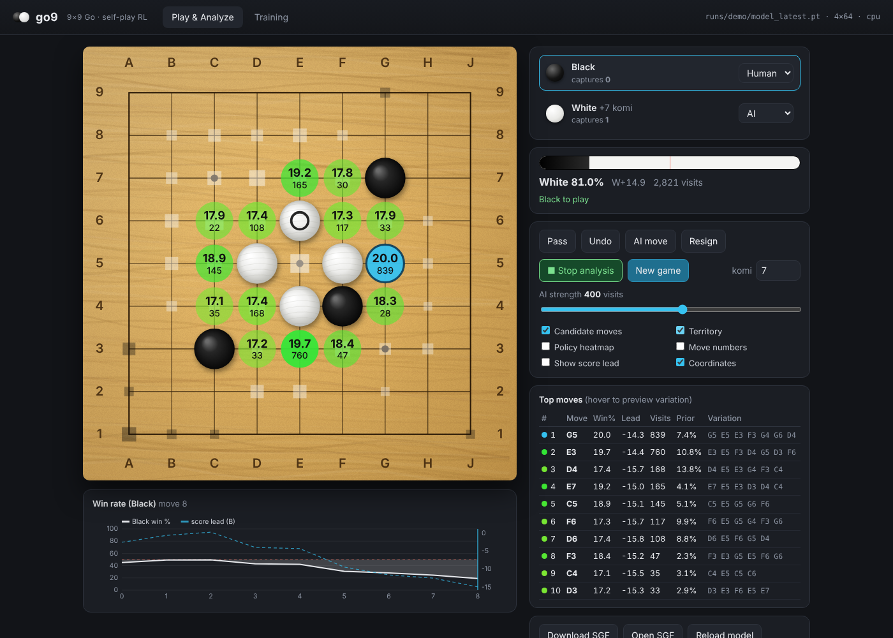
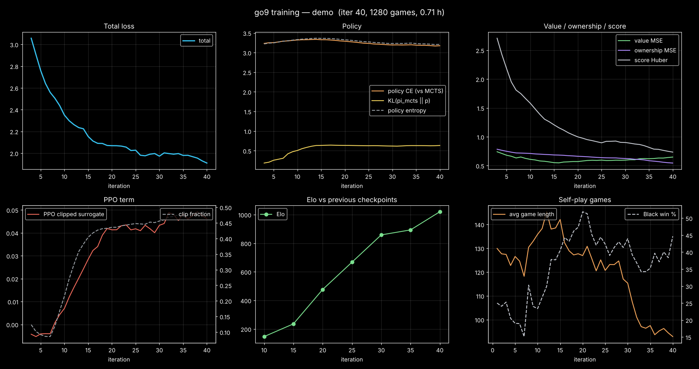
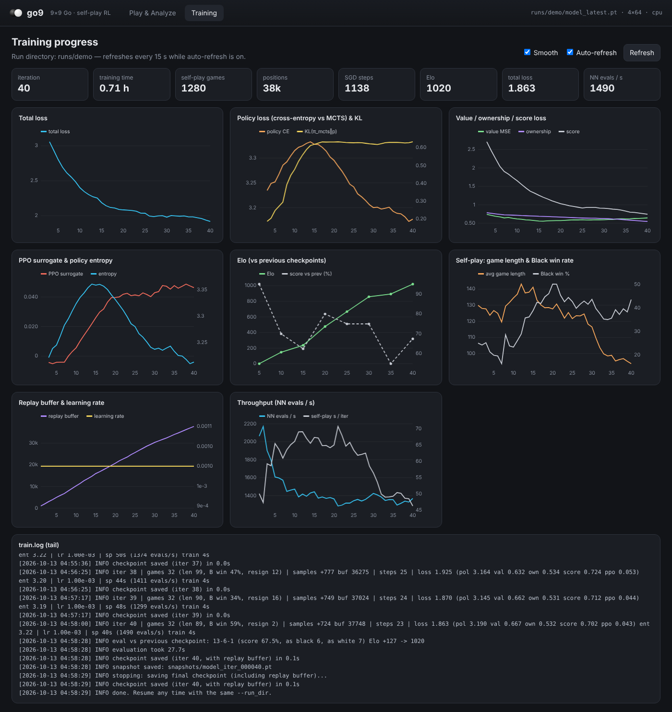

# go9: a 9×9 Go AI that learns by self-play (C++ / LibTorch)

go9 is a complete, self-contained 9×9 Go system:

* **Go environment**: a fast rules engine plus a Gym-style `GoEnv`, cross-validated move-by-move against DeepMind's open-source **OpenSpiel** Go implementation.
* **Reinforcement learning in C++** with **LibTorch** (PyTorch's official C++ distribution). The agent learns purely by **self-play** using AlphaZero/KataGo-style MCTS, combined with a **PPO clipped policy-gradient objective** and **prioritized experience replay**.
* **Browser GUI**: a wooden Go board where you play the AI. Live **KataGo-style analysis** shows the win rate, score lead, visits and principal variation for each candidate move, plus territory and policy heat-maps and a win-rate graph. A **training dashboard** charts the loss curves, Elo and self-play statistics.
* **GTP engine** with `lz-analyze`/`kata-analyze`, so you can also use it from **Sabaki**, **Lizzie**, GoGui, …
* **Checkpoint & resume**: model, optimizer, replay buffer and counters are saved. Stop with Ctrl+C at any time and continue later, for as long as you like.
* Builds and trains on **Windows** (Visual Studio + NVIDIA GPU or CPU). Linux and macOS work too.



---

## Contents
1. [Quick start (Windows)](#quick-start-windows)
2. [Quick start (Linux / macOS)](#quick-start-linux--macos)
3. [Commands](#commands)
4. [How the learning works](#how-the-learning-works)
5. [Training, logging, resuming](#training-logging-resuming)
6. [Getting a *really* strong AI](#getting-a-really-strong-ai)
7. [The GUI](#the-gui)
8. [Using Sabaki / Lizzie (GTP)](#using-sabaki--lizzie-gtp)
9. [The environment API](#the-environment-api)
10. [Testing & validation](#testing--validation)
11. [Project layout](#project-layout)
12. [Troubleshooting](#troubleshooting)

---

## Quick start (Windows)

**Prerequisites**
* **Visual Studio 2022** with the *Desktop development with C++* workload (includes CMake).
* For GPU training: a recent **NVIDIA driver**. You do **not** need the CUDA toolkit, because go9 links LibTorch's DLLs directly.

**Build** (from a *Developer PowerShell for VS 2022*, in the repository folder):

```powershell
# NVIDIA GPU (RTX 20xx / 30xx / 40xx / 50xx) - downloads LibTorch 2.7.1 + CUDA 12.8 (~3 GB)
.\scripts\setup_windows.ps1

# Older GPUs (GTX 10xx):            .\scripts\setup_windows.ps1 -Variant cu118
# CPU only:                          .\scripts\setup_windows.ps1 -Variant cpu
# Already have PyTorch via pip:      .\scripts\setup_windows.ps1 -UsePipTorch
# Already downloaded LibTorch:       .\scripts\setup_windows.ps1 -TorchRoot D:\libtorch
```

The script downloads LibTorch, builds `build\Release\go9.exe`, runs the unit tests, the OpenSpiel cross-validation, a rules self-test and a speed benchmark.

> If PowerShell refuses to run scripts: `Set-ExecutionPolicy -Scope Process Bypass`.

**Train**:

```powershell
build\Release\go9.exe train --config configs\gpu.ini --run_dir runs\main
```

Press **Ctrl+C** whenever you want to stop. go9 finishes the current step and saves everything. Running the **same command again resumes** where it stopped.

**Play and watch the training** (in a second terminal, even while training runs):

```powershell
build\Release\go9.exe gui --run runs\main --open
```

The browser opens at <http://127.0.0.1:8080>. Click **Reload model** at any time to load the newest checkpoint.

## Quick start (Linux / macOS)

```bash
pip install torch            # or download LibTorch and set TORCH_ROOT=/path/to/libtorch
./scripts/build.sh           # configure, build, test
./build/go9 train --config configs/cpu.ini --run_dir runs/main     # or configs/gpu.ini
./build/go9 gui --run runs/main --open
```

Manual CMake: `cmake -S . -B build -DTORCH_ROOT=<libtorch or site-packages/torch> && cmake --build build -j`.
The classic `-DCMAKE_PREFIX_PATH=<libtorch>` (`find_package(Torch)`) also works. For CUDA builds that route needs the CUDA toolkit installed, which is why `TORCH_ROOT` is the recommended way.

---

## Commands

| Command | What it does |
|---|---|
| `go9 train [--config F] [--run_dir D] [--key value …]` | Self-play RL training. Resumes automatically if `D` has a checkpoint. Every config key can be overridden on the command line, e.g. `--full_sims 800`. |
| `go9 gui [--run D \| --model F] [--port 8080] [--visits 400] [--open]` | Browser GUI: play, analyse, training dashboard. |
| `go9 play [--run D] [--color black\|white] [--visits 400]` | Play the AI in the terminal (ASCII board). |
| `go9 gtp [--run D \| --model F] [--visits 400]` | GTP engine for Sabaki / Lizzie / GoGui. |
| `go9 match --a A.pt --b B.pt\|random [--games 40] [--sims 100] [--sgf out.sgf]` | Head-to-head evaluation with Elo estimate. |
| `go9 config` | Print all training settings with their defaults. |
| `go9 selftest` | Thousands of random moves with rules invariants checked. |
| `go9 bench [--model F]` | Neural-net throughput and MCTS speed on your hardware. |

`--device auto|cpu|cuda|cuda:1` works for every command (`auto` uses the GPU when available).

---

## How the learning works

```
            ┌──────────────── one training iteration ────────────────┐
 network ─► │ self-play (batched MCTS, many parallel games, threads)  │
    ▲       │        │ positions + search policies + outcomes          │
    │       │        ▼                                                │
    │       │ prioritized replay buffer (sum tree, IS weights)        │
    │       │        │ minibatches (random board symmetry)             │
    └────── │ SGD: policy distillation + value + ownership + score    │
            │      + PPO clipped surrogate (+ entropy)                │
            │ log metrics • save checkpoint • evaluate Elo            │
            └─────────────────────────────────────────────────────────┘
```

**Network** (`src/nn/model.cpp`): a ResNet trunk (default 6 blocks × 96 channels; `configs/gpu.ini` uses 10 × 128). Every third block uses KataGo-style **global pooling**. The heads are:
* *policy*: 82 logits (81 points + pass),
* *value*: expected result for the player to move,
* *score*: expected final score lead,
* *ownership*: who will own each point. This is an auxiliary target that speeds up learning a lot (KataGo), and it powers the territory overlay in the GUI.

Input: 20 feature planes (stones for the last 4 positions, liberties 1/2/3+, legal moves, last move, side to move, komi, "opponent just passed").

**Search** (`src/mcts/mcts.cpp`): PUCT MCTS with batched leaf evaluation (virtual loss), first-play urgency, Dirichlet root noise in self-play, subtree reuse, and exact scoring of finished games.

**Self-play** (`src/train/selfplay.cpp`): many games run in parallel so the network sees big batches (GPU-friendly). It uses:
* *Playout-cap randomization* (KataGo): 25 % of moves get a full search (e.g. 400 visits) and become policy training targets; the rest use a cheap search (e.g. 80 visits) to keep games flowing.
* Temperature sampling for the first moves, for opening variety.
* *Calibrated resignation*: 20 % of games may never resign, and the measured false-resign rate is logged.

**Losses** (`src/train/trainer.cpp`), selected with `algo`:

| `algo` | Self-play acting | Policy update | Notes |
|---|---|---|---|
| `hybrid` **(default)** | MCTS | cross-entropy to the MCTS visit distribution **+** PPO clipped surrogate (`w_ppo`) | AlphaZero's proven policy-improvement operator plus a PPO term that pushes up actions with positive GAE advantage. |
| `alphazero` | MCTS | cross-entropy to the MCTS visit distribution | Classic AlphaZero/KataGo. |
| `ppo` | raw policy sampling (no search) | PPO clipped surrogate + entropy bonus | Pure PPO. Very fast games, but for Go it is much weaker per hour than search-based training. MCTS is still used when you play it. |

All modes also train the value (MSE to the game outcome), ownership and score heads, and all modes sample minibatches from **prioritized experience replay**:
* priority = |value error| / 2 + KL(MCTS policy ‖ network policy), with α = 0.6;
* new samples get the maximum priority;
* importance-sampling weights use β annealed from 0.4 to 1.

PPO data comes from replay instead of being strictly on-policy. The ratio clipping (`ppo_clip`) together with the stored behaviour log-probabilities keeps those updates conservative. Advantages use GAE (`gae_lambda`) over the alternating-player trajectory, with γ = 1.

The default is `hybrid` because MCTS distillation is what makes Go engines strong (AlphaGo Zero, KataGo). Pure PPO on raw policy rollouts is known to plateau much lower. You can still switch with `--algo ppo` or `--algo alphazero`, or tune `--w_ppo`.

---

## Training, logging, resuming

Everything for a run lives in its run directory:

| File | Contents |
|---|---|
| `config.ini` | the configuration used (reloaded automatically on resume) |
| `model_latest.pt` | latest network (weights + architecture) |
| `optimizer_latest.pt` | AdamW/SGD state |
| `replay.bin` | the prioritized replay buffer (saved every `replay_save_every` iterations and on exit) |
| `state.txt` | iteration, games, SGD steps, Elo, training hours |
| `metrics.csv` | one row per iteration: all losses, entropy, KL, PPO clip fraction, learning rate, game length, Black win rate, resign/false-resign rate, throughput, Elo |
| `eval.csv` | evaluation matches (current vs previous checkpoint → Elo) |
| `train.log` | human-readable log |
| `snapshots/model_iter_XXXXXX.pt` | permanent copies every `snapshot_every` iterations |
| `sgf/latest_selfplay.sgf`, `sgf/eval_latest.sgf` | sample games you can open in any SGF viewer or in the GUI |

* **Stop:** Ctrl+C (once) saves everything. A second Ctrl+C aborts immediately; the last per-iteration checkpoint is kept.
* **Resume:** run the same `go9 train --run_dir …` command. Command-line overrides are applied on top of the saved `config.ini`, so you can change e.g. `--lr` or `--full_sims` mid-run. The network size is fixed by the saved model.
* **Loss curves:**
  * live in the GUI's **Training** tab (`go9 gui --run runs/main`),
  * as a PNG: `python tools/plot_training.py runs/main` → `runs/main/training_curves.png` (`pip install matplotlib`).
* **Elo:** every `eval_every` iterations the current network plays `eval_games` games against the network from the previous evaluation. The accumulated Elo is plotted, and the first evaluation is a sanity check against a random player.



---

## Getting a *really* strong AI

9×9 Go is small enough that a single consumer GPU can reach strong amateur-dan level and beyond with enough self-play time. Practical advice:

1. **Use the GPU preset** (`configs/gpu.ini`). Check `go9 bench --device cuda`: a 10×128 network should reach tens of thousands of NN evaluations per second at batch 256 on a modern GPU. If the GPU is under-used, raise `parallel_games` and/or `selfplay_threads`.
2. **Let it run.** Expect clear progress within hours and strong play after days. The Elo curve in the dashboard shows whether it is still improving.
3. **Scale search with strength.** Once the Elo climb flattens, raise `--full_sims` (400 → 800 → 1600) and `--fast_sims`. Bigger searches give better training targets.
4. **Bigger network.** For a new run, use e.g. `--blocks 15 --channels 192`. The architecture is fixed per run, so compare it to the old run with `go9 match --a new.pt --b old.pt`.
5. **Learning rate.** The default cosine schedule decays over `lr_decay_iters`. For very long runs, increase it, or resume with a lower `--lr`.
6. Keep `snapshots/`, so you can always measure progress with `go9 match`.
7. When playing, more visits = stronger. Use the *AI strength* slider in the GUI or `--visits` for GTP.

---

## The GUI

`go9 gui --run runs/main --open`

* **Board**: wood texture, shaded stones, coordinates, last-move and ko markers; click to play and hover for a ghost stone.
* **Players**: each colour can be *Human* or *AI* (Human-vs-AI, AI-vs-AI, or a two-human analysis board).
* **Analysis** (`A` or ▶ Analyze): continuous MCTS on the current position, like KataGo/Lizzie.
  * Candidate moves are drawn on the board with **win rate %** and **visits** (or score lead).
  * Colours: best move **cyan**, then green → yellow → red as the win-rate loss grows.
  * Hover a candidate (on the board or in the *Top moves* table) to preview its **principal variation** with numbered stones.
* **Territory** overlay (ownership head) marks expected territory and dead stones. **Policy heatmap** shows the raw network prior.
* **Evaluation bar** and **win-rate graph** (Black's win %, plus score lead) over the whole game.
* Undo, pass, resign, new game with any komi, **SGF download/open**, **Reload model** (picks up the newest checkpoint while training runs).
* **Training tab**: KPIs and charts for losses, policy KL & entropy, PPO term, Elo, game length / Black win rate, replay buffer & LR, throughput, plus the tail of `train.log`. It auto-refreshes.

Keyboard: `P` pass · `U` undo · `A` analyze · `Space` AI move.



Scoring follows **area (Chinese / Tromp-Taylor) rules**. After two passes, every stone on the board counts as alive. Capture dead stones before passing, or turn on *Territory* to see what the network thinks is dead.

The AI follows a *Tromp-Taylor-safe pass* rule, both in play and in self-play. When you have just passed, the AI's pass would end the game, so it only does that if the board as it stands is a win for it. Otherwise it keeps playing (capturing dead stones) instead of passing into a loss.

---

## Using Sabaki / Lizzie (GTP)

Add an engine with the command `C:\path\to\go9.exe` and the arguments `gtp --run C:\path\to\runs\main --visits 800`.
* Supported commands: `genmove`, `play`, `undo`, `komi`, `clear_board`, `final_score`, `showboard`, `printsgf`, `lz-analyze`, `kata-analyze` (with `ownership true`), `lz-genmove_analyze`, `kata-genmove_analyze`, `go9-visits N`.
* Sabaki's and Lizzie's analysis modes show the live win rates and variations.

---

## The environment API

```cpp
#include "go/env.h"

go::GoEnv env(/*komi=*/7.0f, go::KoRule::PositionalSuperko, /*max_moves=*/243);
std::vector<float> obs = env.reset();          // 19 x 9 x 9 feature planes for the player to move
while (!env.done()) {
  std::vector<int> legal = env.legal_actions(); // 0..80 = points (row-major from A9), 81 = pass
  go::StepResult r = env.step(legal[rand() % legal.size()]);
  // r.reward: +1 / -1 (0 for jigo) for the player who just moved, only when r.done
}
std::cout << env.render() << env.result_string() << "\n" << env.to_sgf();
```

Rules:
* area scoring with komi (default 7.0, so jigo is possible);
* suicide is illegal;
* **positional superko** by default, or `KoRule::Simple`;
* the game ends after two consecutive passes or at `max_moves`.

`go::Board` exposes the lower-level API: legality, Zobrist hashing, liberties, ownership and snapshots for the network.

---

## Testing & validation

```bash
build/go9_tests                                           # 45 unit tests
build/go9_crossval tests/data/openspiel_games.txt         # rules vs. OpenSpiel
build/go9 selftest                                        # random-play invariants
ctest --test-dir build                                    # all of the above via CTest
```

* **Unit tests**:
  * rules: captures, multi-group captures, suicide, ko and superko, scoring with dame, pass handling, hashing, feature encoding, the 8 board symmetries;
  * environment: rewards, undo, resign, SGF round-trips;
  * replay buffer: sampling proportional to priority, IS weights, save/load;
  * MCTS: visit accounting, exact terminal values, tree reuse, noise;
  * network: shapes, save/load, illegal-move masking;
  * self-play sample validity, GAE correctness, *training reduces loss*, and *checkpoint → resume restores identical weights, optimizer and replay*.
* **Cross-validation against OpenSpiel** (DeepMind's open-source game library): `tools/gen_openspiel_crossval.py` records random games played by OpenSpiel's Go, including every position's legal-move set. go9 must agree on every legal-move set, on when the game ends, and on the winner.
  * Verified on 400 games (82,336 positions) during development.
  * The repository ships a 60-game fixture.
  * OpenSpiel uses simple ko and declares a draw when a whole-board position repeats. go9's positional superko forbids exactly those moves, and the test checks that too.

---

## Project layout

```
src/go/        board.{h,cpp} rules engine · env.{h,cpp} Gym-style env + SGF
src/nn/        features (input planes, symmetries) · model (ResNet, LibTorch) · evaluator (batched inference)
src/mcts/      PUCT search
src/train/     config · replay (PER) · selfplay · trainer (losses, checkpoints) · arena (Elo)
src/play/      game/search wrapper shared by GUI and GTP
src/server/    HTTP server for the web GUI (cpp-httplib)
src/gtp/       GTP front-end
web/           GUI (HTML/CSS/JS, no external dependencies, works offline)
configs/       default.ini, gpu.ini, cpu.ini, ppo.ini
tools/         plot_training.py, gen_openspiel_crossval.py
tests/         unit tests, OpenSpiel cross-validation
third_party/   cpp-httplib (MIT)
```

Open-source building blocks: **LibTorch** (BSD), **cpp-httplib** (MIT, vendored), **OpenSpiel** (Apache-2.0, for validation only). The techniques follow published work: AlphaGo Zero / AlphaZero (MCTS distillation), KataGo (global pooling, ownership/score heads, playout-cap randomization), PPO (Schulman et al. 2017) and prioritized experience replay (Schaul et al. 2015).

---

## Troubleshooting

* **`device: cpu` although you have an NVIDIA GPU**:
  * Build with a CUDA LibTorch (`-Variant cu128`/`cu126`/`cu118`).
  * Update the GPU driver.
  * Make sure the LibTorch DLLs are next to `go9.exe`; the build copies them automatically.
* **RTX 50xx (Blackwell)** needs a CUDA 12.8+ LibTorch (`cu128`).
* **`Could not find the web/ directory`**: run from the repository root or pass `--web path\to\web`. The build also copies `web/` next to the executable.
* **Port in use**: `go9 gui --port 8090`.
* **Out of GPU memory**: lower `parallel_games` or `batch_size`.
* **Training seems slow on CPU**: use `configs/cpu.ini` and a smaller network. CPU training works but is ~10–50× slower than a GPU.
* **Everything gets very slow when two go9 processes share the CPU** (for example training on the CPU while the GUI analyses on the CPU): each process spins a full set of LibTorch/OpenMP threads, and oversubscribed CPUs slow down dramatically. Give the second process fewer threads, e.g. `go9 gui --run runs\main --threads 1`, or set `--torch_threads` for training. GPU training is not affected.
* **Changing the network size of an existing run** is not possible. Start a new `--run_dir`.
