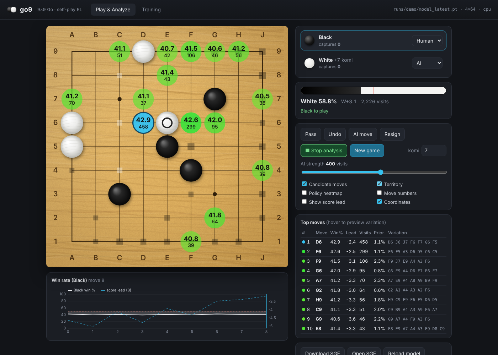
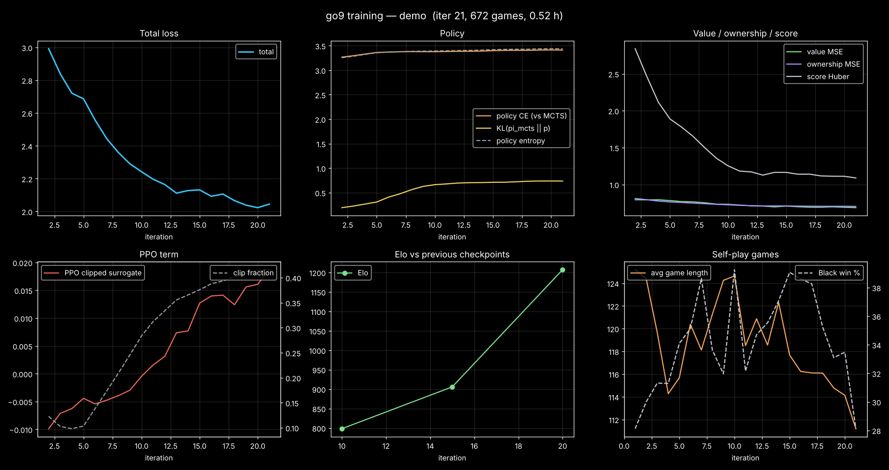

# go9py: the Python version

`go9py` is a pure-Python (NumPy + PyTorch) version of go9, with the same features as the C++ version:

* a **9×9 Go environment**: rules engine, Gym-style `GoEnv`, optional `gymnasium` wrapper, SGF import/export. It is cross-validated position-by-position against DeepMind's **OpenSpiel**.
* **self-play reinforcement learning** with MCTS, a **PPO** clipped policy-gradient term and **prioritized experience replay**.
* **checkpoint / resume**, loss curves, Elo tracking and logging.
* the **browser GUI**, unchanged: it talks to a Python HTTP server with the same API. You get KataGo-style candidate moves with win rate %, visits, score lead, variations, territory and a training dashboard.
* a **terminal** mode and a **GTP** engine for Sabaki / Lizzie / GoGui.

There is nothing to compile. On Windows it is the quickest way to get started; the C++ version (repository root) trains several times faster.



A 35-minute CPU-only demo run (4 blocks × 64 channels, 21 iterations, 672 self-play games) beat a random player 40–0 and its own iteration-10 checkpoint 39–1:



---

## 1. Install

You need **Python 3.9+**. On Windows, install it from python.org and tick "Add python.exe to PATH".

```powershell
cd path\to\9-by-9-Go-AI\python
python -m venv .venv
.venv\Scripts\activate                # Linux/macOS: source .venv/bin/activate

# PyTorch: pick ONE line
pip install torch --index-url https://download.pytorch.org/whl/cu128   # NVIDIA GPU (RTX 20xx-50xx)
pip install torch --index-url https://download.pytorch.org/whl/cu118   # older NVIDIA GPUs
pip install torch                                                       # CPU only (or Apple Silicon)

pip install -r requirements.txt        # numpy, matplotlib (plots), pytest (tests)
pip install gymnasium                  # optional: gymnasium.Env wrapper
```

Optionally, `pip install -e .` installs the `go9py` command. Otherwise use `python -m go9py` from this folder, as all examples below do.

Check that everything works:

```powershell
python -m pytest -q                    # 43 tests (rules, OpenSpiel cross-check, MCTS, replay, training, resume, GUI API, GTP)
python -m go9py selftest               # random games with rules invariants checked
python -m go9py bench                  # speed of your CPU/GPU
```

`bench` should report `cuda` if you installed the GPU build. If it says `cpu`, reinstall torch with the CUDA index URL above.

## 2. Train

```powershell
python -m go9py train --run_dir runs\main --device cuda --blocks 10 --channels 128 --games_per_iter 128 --parallel_games 128 --full_sims 200 --fast_sims 40
```

or, on a CPU only:

```powershell
python -m go9py train --run_dir runs\cpu --device cpu --blocks 4 --channels 64 --full_sims 64 --fast_sims 16 --min_replay 2000
```

* **Stop:** press **Ctrl+C**. go9py finishes the current step and saves the model, optimizer, replay buffer and counters.
* **Resume:** run the same command again. The saved `config.ini` is reloaded, and your command-line options are applied on top, so you can e.g. raise `--full_sims` later.
* **Settings:** every key from `python -m go9py config` can be set with `--key value`, or saved in a file used with `--config my.ini`. The C++ preset files `../configs/*.ini` use the same keys.
* **Algorithm:**
  * `--algo hybrid` (default): MCTS distillation + PPO term.
  * `--algo alphazero`: MCTS distillation only.
  * `--algo ppo`: pure PPO on raw-policy rollouts; also set `--w_policy 0 --w_ppo 1 --w_entropy 0.01`.

What a run directory contains:

| File | Contents |
|---|---|
| `checkpoint.pt` | model + optimizer + counters (used to resume) |
| `model_latest.pt` | latest network (for the GUI / GTP / match) |
| `replay.npz` | prioritized replay buffer |
| `config.ini` | configuration |
| `metrics.csv` | one row per iteration: losses, entropy, KL, PPO clip fraction, LR, game length, Black win rate, throughput, Elo |
| `eval.csv` | evaluation matches (Elo vs previous checkpoint) |
| `train.log` | readable log |
| `snapshots/` | model copies every `snapshot_every` iterations |
| `sgf/` | sample self-play / evaluation games |

**Loss curves:**
* live in the GUI's *Training* tab;
* as a PNG: `python ..\tools\plot_training.py runs\main` writes `runs\main\training_curves.png`.

## 3. Play and analyse in the browser

```powershell
python -m go9py gui --run runs\main --open          # or --model some_model.pt, --port 8090, --visits 800
```

* Click to play. Choose Human/AI for each colour. **▶ Analyze** (key `A`) runs continuous search.
* Candidate moves show **win rate %** and **visits** (or score lead): the best move in cyan, others green → yellow → red.
* Hover a move to preview its variation.
* Toggles: territory (ownership), policy heat-map, move numbers.
* There's a win-rate graph, SGF download/upload, and *Reload model* to pick up the newest checkpoint while training runs.
* The **Training** tab charts the loss curves, Elo and self-play statistics of `--run`.

Keys: `P` pass · `U` undo · `A` analyze · `Space` AI move.

## 4. Other ways to play

```powershell
python -m go9py play --run runs\main --color black --visits 400     # terminal (type D5, pass, undo, resign, quit)
python -m go9py gtp  --run runs\main --visits 800                    # GTP engine (Sabaki / Lizzie)
python -m go9py match --a runs\main\model_latest.pt --b random --games 40 --sims 100
python -m go9py match --a runs\main\model_latest.pt --b runs\main\snapshots\model_iter_000050.pt
```

To use **Sabaki** or **Lizzie**, add an engine:
* path: `C:\path\to\python\.venv\Scripts\python.exe`
* arguments: `-m go9py gtp --run C:\path\to\runs\main`
* working directory: this `python` folder.

`lz-analyze` and `kata-analyze` are supported, so their analysis overlays work.

## 5. Use the environment in your own code

```python
import random
from go9py import GoEnv, PASS, action_to_gtp

env = GoEnv(komi=7.0)                       # positional superko, area scoring, ends after 2 passes
obs = env.reset()                           # numpy (20, 9, 9) planes for the player to move
while not env.done:
    a = random.choice(env.legal_actions())  # 0..80 = points (row-major from A9), 81 = pass
    obs, reward, done, info = env.step(a)   # reward +1/-1 (0 jigo) for the mover, at the end
print(env.render(), env.result_string())
print(env.to_sgf())

# gymnasium (pip install gymnasium):
from go9py.env import GymGoEnv
genv = GymGoEnv()
obs, info = genv.reset(seed=0)              # info["action_mask"] marks legal moves
```

Lower-level pieces:
* `go9py.board.Board`: legality, captures, hashing, scoring;
* `go9py.mcts.Search`: search;
* `go9py.model.GoNet` / `Evaluator`: network and batched inference;
* `go9py.replay.ReplayBuffer`: prioritized replay;
* `go9py.trainer.Trainer`: the training loop.

## 6. How it works (short)

* **Network:** a ResNet (blocks × channels configurable). Every third block has a KataGo-style global-pooling bias. The heads are policy (82), value, score lead and ownership. Input: 20 feature planes, identical to the C++ version.
* **Self-play:** many games run in parallel, so the network evaluates large batches. Search uses PUCT MCTS with virtual loss, first-play urgency, Dirichlet root noise and subtree reuse.
  * *Playout-cap randomization:* only 25 % of moves get a full search, and only those become policy targets.
  * *Calibrated resignation* starts after `resign_start_iter`.
  * *Tromp-Taylor-safe passing:* after the opponent passes, the engine never passes into a loss on the current count.
* **Loss:**
  * policy cross-entropy vs. the MCTS visit distribution;
  * value MSE, ownership MSE and score Huber loss;
  * the PPO clipped surrogate with GAE advantages;
  * an optional entropy bonus.

  Losses are weighted by the PER importance weights, and the new priority = |value error| / 2 + KL(MCTS ‖ network).
* **Evaluation:** every `eval_every` iterations the current net plays the previous evaluated net, and the Elo difference accumulates.

## 7. Python vs. C++ version

| | go9py (this folder) | go9 (C++, repository root) |
|---|---|---|
| Install | `pip install torch numpy` | Visual Studio + CMake + LibTorch |
| Self-play speed | slower (search runs in Python) | several times faster |
| GUI, GTP, configs, rules | same | same |
| Checkpoint files | `.pt` (PyTorch `state_dict`) | LibTorch archive |

The two versions use the same rules, features and architecture, but **their model files are not interchangeable**.

## 8. Troubleshooting

* **`device: cpu` despite an NVIDIA GPU:** reinstall torch with a CUDA index URL (section 1) and update the driver.
* **Everything is slow when training and the GUI share a CPU:** give one of them fewer threads, e.g. `python -m go9py gui --run runs\main --threads 1`.
* **Port already in use:** `--port 8090`.
* **"Could not find the web GUI":** run from this folder, or pass `--web ..\web`.
* **Out of GPU memory:** lower `--parallel_games` / `--batch_size`.
